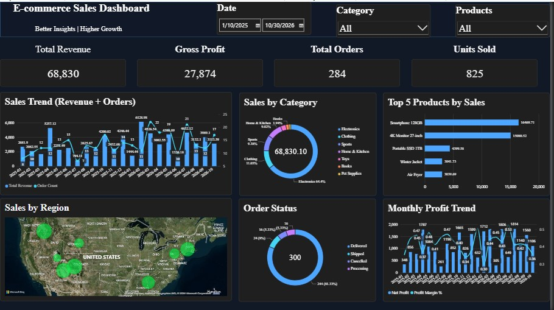
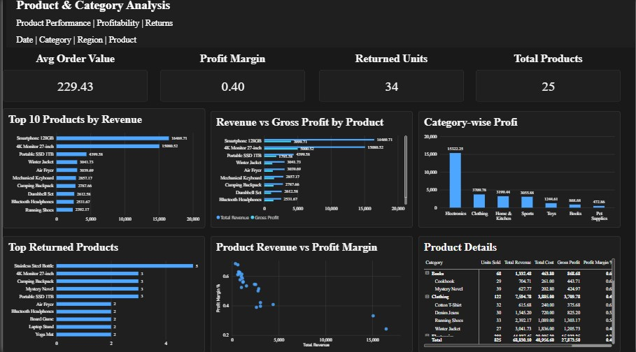
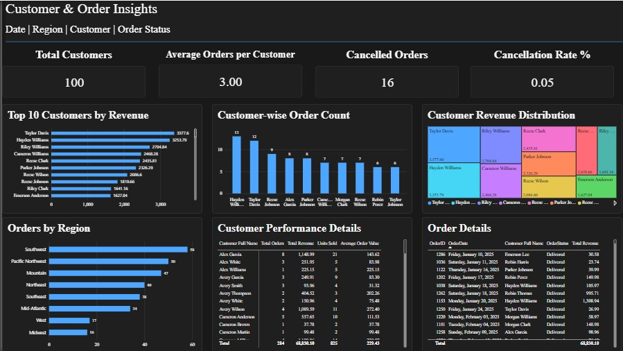

# E-Commerce Sales Analytics Dashboard

## Project Overview
E-Commerce Sales Analytics using SQL Server and Power BI | Data Analysis, Business Insights & Interactive Dashboard.

## Key Features
- Total Revenue and Gross Profit Analysis
- Sales Performance Trends
- Top 5 Products by Sales
- Top 10 Products by Revenue
- Category-wise Sales Analysis
- Customer Analysis
- Regional Sales Analysis
- Interactive Filters and Drillthrough

## Tools & Technologies
- Microsoft Power BI
- DAX
- Power Query

## Project Objectives
- Analyze overall sales performance.
- Identify top-performing products and categories.
- Understand customer purchasing behavior.
- Evaluate regional sales performance.
- Support data-driven business decisions.

## Dashboard Preview

### E-Commerce Overview

### Sales Analysis

### Customer Analysis

## Project Files
Power BI Dashboard (.pbix)

